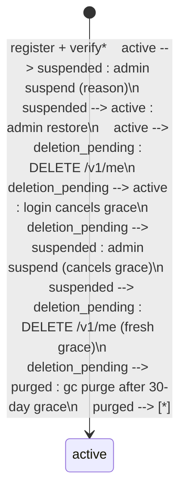

# User lifecycle (P1-012)

The account's states, what moves it between them, what each
state allows, what is kept and for how long (NFR-40), and the
admin procedures. This is the map; the endpoints live in the
[api-spec](03-api-spec.md) (admin section, login, profile,
deletion), the schema + retention table in the
[data-model](04-data-model.md), the threats in the
[threat model](../threat-model.md) (T17–T21), and the tests
that prove each transition in the
[security-testing plan](../05-QUALITY/03-security-testing.md).

## State diagram

\* Registration creates the account as `active` immediately
— there is no separate "unverified" status. An unverified
email does not change the status; it gates job creation
(PF-1009), not the account. Email verification is a
timestamp (`email_verified_at`), not a state.

Notes on the diagram:

- **Three statuses, one terminal absence.** `status` is
  `active`, `suspended`, or `deletion_pending` (the `users`
  CHECK admits nothing else). "Purged" is not a status — the
  row is hard-deleted, and the cascade takes its sessions,
  jobs, uploads, subscriptions, usage counters, idempotency
  keys, verification tokens, and attestations with it
  (P1-007). Audit rows survive the purge with the actor id
  intact; outbox rows survive (addressed by hash); S3
  objects become orphans for the next gc sweep.
- **`deleted_at` is non-NULL exactly when the status is
  `deletion_pending`** (P1-008 invariant). A suspend clears
  it (the grace does not survive admin intervention); a
  restore clears it; a login cancels it. The audit's
  `before` records the prior status + `deleted_at` when a
  suspend cancels a grace.
- **A suspended user is never purged.** The purge only takes
  `deletion_pending` past the 30-day grace. A suspended
  account sits until an admin restores it — or the user
  requests deletion themself, which moves it to
  `deletion_pending` with a fresh grace (verified live by a
  scratch run during P1-012: a suspended user's DELETE
  returns 204 and the status becomes `deletion_pending`).
- **No-ops, not errors.** Suspending an already-suspended
  account, restoring a non-suspended account, and a second
  DELETE while pending are all 200/204 no-ops — no write, no
  audit, no second mail. The grace always runs from the
  FIRST deletion request, never restarted.
- **Lockout is not a state.** A locked account (P1-004: 5
  failures in 15 min, 60 s doubling to a 1-hour cap, 423
  `PF-1008`) is still `active` — the lock lives in
  `login_attempt_counters`, unlocks on its own, and resets
  on a successful login. Suspension is the admin's lock; it
  needs a restore.

## What each state allows

| | active | suspended | deletion_pending |
| --- | --- | --- | --- |
| Log in | yes (verified email not required) | no — 403 `PF-1003` after a correct password, generic 401 after a wrong one (no info leak) | yes — and the login CANCELS the grace (status back to `active`, in the same tx as the new session) |
| Create jobs | yes, if the email is verified (PF-1009) and quota allows | no new token, so no new jobs — but see the residual window below | yes (the grace is a cooling-off, not a lockout) |
| Read / change profile (`GET` / `PATCH /v1/me`) | yes | yes, while a token is still valid — the extractor does not check status (see below) | yes |
| Request deletion (`DELETE /v1/me`) | yes → `deletion_pending`, 30-day grace | yes → `deletion_pending` with a FRESH grace (the suspend is undone by the user's own request) | no-op (grace runs from the first request) |
| Admin suspend / restore | suspend → `suspended` | restore → `active`; suspend again is a no-op | suspend → `suspended` (cancels the grace); restore is a no-op (restore only acts on `suspended`) |
| Purged by gc | no | no | yes, once `deleted_at` is 30+ days old (`detag-gc --purge-users`, nightly, dry-run by default) |

**The residual window (suspended).** Suspension revokes
every session (no new access token can be minted) and
blocks the next login — but the access token already issued
is stateless and stays valid until it expires (≤ 15 min).
Inside that window the token still works on user routes
(the extractor does not check status, by design — P1-008).
The window closes at expiry and cannot be reopened. This
is a documented trade-off in the threat model, not an
oversight.

## Retention (NFR-40)

NFR-40 (`02-REQUIREMENTS/03-non-functional-requirements.md`):
"Result artifacts expire per plan TTL and are hard-deleted;
audit log 365 d; app logs 90 d; webhook delivery logs 30 d."

| Data | Retention | Enforced by | Status |
| --- | --- | --- | --- |
| Result artifacts | Plan TTL, then hard delete (object + row) | `detag-gc` artifact sweep (daily worker) | LIVE — TTLs in the plans seed: Free 6 h, Pro 24 h, Business 72 h |
| User rows (`deletion_pending`) | 30-day grace, then hard delete + cascade | `detag-gc --purge-users` (nightly, dry-run by default) | LIVE (P1-007) |
| Uploads (`pending_parts`) | > 24 h → abort + delete | — | TARGET — the upload state machine allows `pending_parts → aborted` (always legal), but no job aborts stale pending uploads yet; covered by P5-017 with the other NFR-40 schedules |
| Audit log (`audit_logs`) | 365 d | — | TARGET — no prune job exists yet; enforced by P5-017 (retention jobs verify, with an evidence table) |
| App logs | 90 d | Log shipper / rotation (deployment) | TARGET — same ticket (P5-017) |
| Webhook delivery logs (`webhook_deliveries`) | 30 d | — | TARGET — same ticket (P5-017) |
| Email outbox, sent rows (`email_outbox`) | 30 d | — | TARGET — same ticket (P5-017) |
| Usage counters (`usage_counters`) | 400 d | — | TARGET — same ticket (P5-017) |

Honesty note: the data-model's retention section lists all
eight rows as the design; only the first two are enforced
by a running job today. The remaining six are retention
TARGETS — the rows are kept, nothing deletes them yet, and
P5-017 is the ticket that makes them run (in staging first,
with an evidence table of what expired when). Do not quote
"365 d" to anyone as an enforced deletion until P5-017
lands. (The audit rows' survival through the user purge is
a separate, already-live rule: the purge never deletes audit
rows — the audit trail is never deleted, only aged out by
the 365-day prune when it exists.)

## Admin procedures

**Suspend / restore (P1-008).** `POST
/v1/admin/users/{id}/suspend` with `{"reason": "..."}`
(1–500 chars, required — an admin action without a reason
is not auditable); `POST /v1/admin/users/{id}/restore`
takes no body. Both return 200 with the updated user and
are idempotent no-ops in the target state. A suspend
revokes every session, holds every queued job, cancels any
pending deletion, and is audited as `user.suspended`
(actor = you). A restore releases held jobs to `queued`,
leaves sessions revoked (the user logs in again), and is
audited as `user.restored`. A running job is never held —
it finishes.

**Search (P1-009).** `GET /v1/admin/users?query=` (email /
display-name / id prefix), cursor pagination. Support may
use it — it is a read.

**Impersonate (P1-010).** `POST
/v1/admin/users/{id}/impersonate` with a reason returns a
15-minute scoped token that acts as the user. Rules: the
console MUST show a persistent banner naming both parties
for the whole session; the token MUST NOT be used for admin
work (the API rejects it with 403 `PF-1002` anyway); every
action taken under it is audited with the admin as the
actor and the user as the target (P1-011). Support may not
impersonate — it is a write.

**Admin creation.** There is no self-service way to become
an admin, and no endpoint creates one. Roles are set out of
band today; who owns the admin-invite CLI is DECISIONS.md
item 8 (owner input needed). Never hand-edit the `role`
column outside the documented procedure — the audit trail
cannot see a `psql` UPDATE.

**When a user asks to be deleted, or to stay.** Only the
user's own login cancels a pending deletion — there is no
admin endpoint for it. If the user cannot log in (lost
password), the password-reset flow is the path (P1-025,
Forgot/reset flow); do NOT "fix" it by restoring —
restore is a no-op for `deletion_pending` and the account
would still purge. Suspending a `deletion_pending` account
cancels the grace but leaves the account suspended, not
active — use it only when the deletion itself must be
stopped and the account must stay out.

**Locked vs suspended.** A user who "cannot log in" is
either locked (423 `PF-1008`, auto-unlocks within an hour,
resets on success — wait it out, or check
`login_attempt_counters`) or suspended (403 `PF-1003`,
needs a restore — check the `user.suspended` audit for who
and why). The login error tells you which: 423 is the
lockout, 403 is the suspension, and a wrong password is
always the generic 401 either way.

**What to check before acting.** Search the user first
(`GET /v1/admin/users?query=` — status, plan, today's
usage), read their audit trail (`GET /v1/admin/audit` —
Phase 4), and act with a reason. Every privileged action
is audited; the audit is the record the user, the owner,
and (if it ever comes to it) a regulator will read.
